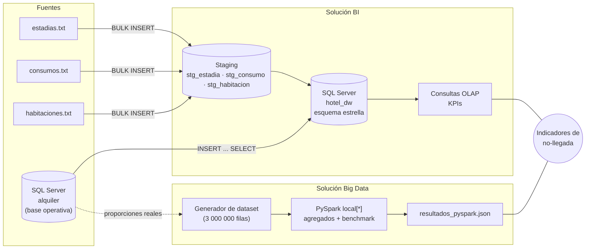
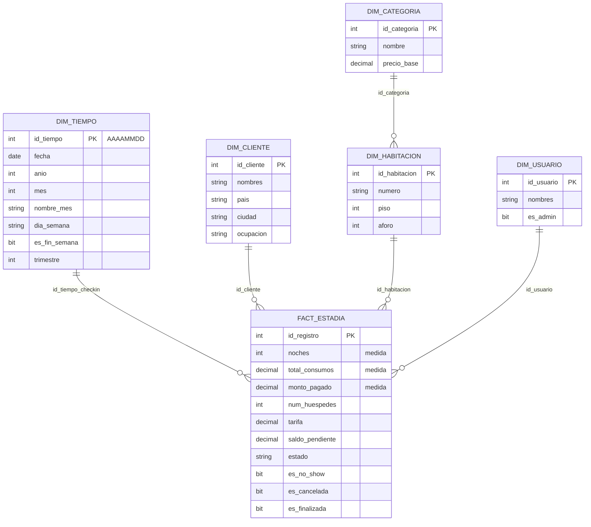
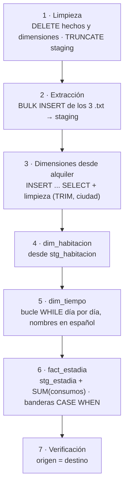

<div align="center">

# 📊 Tunki Lodge · Solución BI y Big Data

**Factores asociados a la no-llegada de huéspedes en el sistema Estadía de Tunki Lodge**


-ED8B00?logo=openjdk&logoColor=white)

</div>

---

## 📑 Tabla de contenidos

- [Descripción general](#-descripción-general)
- [Arquitectura](#-arquitectura)
- [Stack tecnológico](#-stack-tecnológico)
- [Fuente de datos](#-fuente-de-datos)
- [Solución de Inteligencia de Negocios (datamart `hotel_dw`)](#-solución-de-inteligencia-de-negocios-datamart-hotel_dw)
  - [Modelo dimensional](#modelo-dimensional)
  - [Proceso ETL](#proceso-etl)
  - [Ejecución](#ejecución)
  - [Indicadores (KPIs)](#indicadores-kpis)
- [Solución Big Data (PySpark)](#-solución-big-data-pyspark)
- [Requisitos](#-requisitos)
- [Estructura del repositorio](#-estructura-del-repositorio)
- [Limitaciones conocidas y trabajo futuro](#-limitaciones-conocidas-y-trabajo-futuro)
- [Equipo](#-equipo)

---

## 📌 Descripción general

El proyecto construye dos soluciones complementarias sobre los datos de estadías de Tunki Lodge:

| Solución | Propósito | Tecnología |
|---|---|---|
| **Inteligencia de Negocios** | Datamart en esquema estrella, poblado por un proceso ETL que integra la base operativa y archivos planos, con consultas OLAP para los indicadores. | T-SQL · SQL Server (`hotel_dw`) |
| **Big Data** | Procesamiento distribuido de un dataset a escala y benchmark de escalabilidad. | PySpark 4.2.0 (`local[*]`) |

**Problema de negocio.** La concurrencia de clientes en Tunki Lodge viene bajando y no existe una forma de explicar por qué. El evento medible más directo es la **no-llegada** del huésped (**no-show + cancelación**). El proyecto busca determinar si la no-llegada aumenta con el tiempo y en qué segmento se concentra.

| Tipo | Variable |
|---|---|
| **Dependiente** | No-llegada (no-show + cancelación) |
| **Independientes** | Categoría de habitación · día de la semana · anticipación de la reserva |

**Objetivo.** Explicar la caída de concurrencia en el tiempo e identificar los segmentos donde se concentra el aumento de la no-llegada, con al menos 15 puntos porcentuales de diferencia entre segmentos y una medición explícita de la variación de concurrencia mes a mes.

---

## 🏗 Arquitectura



Ambas rutas, BI con datos reales y Big Data con volumen a escala, convergen en los mismos indicadores de no-llegada.

---

## 🧰 Stack tecnológico

| Capa | Tecnología | Versión |
|---|---|---|
| Base de datos | Microsoft SQL Server | 2022 / 2025 |
| ETL | T-SQL: procedimiento almacenado, `BULK INSERT`, `INSERT ... SELECT`, transacciones `TRY/CATCH` | — |
| Herramientas SQL | SSMS · `sqlcmd` | — |
| Procesamiento distribuido | Apache Spark (PySpark) | 4.2.0 |
| Lenguaje | Python | 3 |
| Runtime de Spark | Java (JDK) | 17 |

---

## 🗄 Fuente de datos

La fuente operativa es la base **`alquiler`** del sistema Estadía de Tunki Lodge, en SQL Server. De ella se usan las tablas `categoria`, `cliente`, `usuario`, `habitacion`, `registro` (estadías) y `consumo`.

| Estado de una estadía | Significado | ¿Cuenta como no-llegada? |
|---|---|---|
| `ACTIVA` | Huésped hospedado o reserva vigente | No |
| `FINALIZADA` | Check-out realizado | No |
| `CANCELADA` | Reserva cancelada | **Sí** |
| `NO_SHOW` | El huésped no se presentó | **Sí** |

**Volumen actual:** 21 estadías (agosto–octubre 2026), 9 consumos, 5 habitaciones, 3 categorías.

---

## 📊 Solución de Inteligencia de Negocios (datamart `hotel_dw`)

### Modelo dimensional

**Grano de la tabla de hechos:** una fila = una estadía (un registro de check-in).



| Elemento | Detalle |
|---|---|
| **Dimensiones (5)** | `dim_tiempo`, `dim_categoria`, `dim_habitacion`, `dim_cliente`, `dim_usuario` |
| **Medidas (4)** | `noches`, cantidad de estadías (`COUNT(*)`), `total_consumos`, `monto_pagado` |
| **Staging (3)** | `stg_estadia`, `stg_consumo`, `stg_habitacion` |

> `dim_habitacion` referencia a `dim_categoria` (una pequeña rama de copo de nieve), porque la categoría es el eje principal del análisis de no-llegada.

### Proceso ETL

| N.° | Fuente | Formato | Destino |
|---|---|---|---|
| 1 | Base `alquiler` | Tablas OLTP (`categoria`, `cliente`, `usuario`) | `dim_categoria`, `dim_cliente`, `dim_usuario` vía `INSERT ... SELECT` |
| 2 | `estadias.txt` | Separador `\|`, con encabezado | `stg_estadia` → `dim_tiempo` y `fact_estadia` |
| 3 | `consumos.txt` | Separador `\|`, con encabezado | `stg_consumo` → `total_consumos` |
| 4 | `habitaciones.txt` | Separador `,`, sin encabezado | `stg_habitacion` → `dim_habitacion` |



**Transformaciones aplicadas:**

- Clave de tiempo `AAAAMMDD` y calendario con mes y día de la semana en español.
- Limpieza de espacios (`LTRIM/RTRIM`) y normalización de la ciudad con mayúscula inicial.
- Agregación de consumos por estadía: `SUM(monto) ... GROUP BY registro_id`.
- Medida derivada: `saldo_pendiente = tarifa + total_consumos − monto_pagado`.
- Banderas `es_no_show`, `es_cancelada` y `es_finalizada` calculadas desde el estado.

El proceso completo vive en el procedimiento almacenado **`dbo.usp_etl_cargar_hotel_dw`**, dentro de una **transacción con `TRY/CATCH`**: si cualquier paso falla, se hace `ROLLBACK` y el datamart queda intacto.

### Ejecución

```powershell
# 1. Copiar las fuentes planas a la carpeta que lee BULK INSERT
mkdir C:\txt\tunki
copy bi\fuentes\*.txt C:\txt\tunki\

# 2. Crear el datamart y ejecutar el ETL
sqlcmd -S localhost -U sa -P "<contraseña>" -C -i bi\crear_hotel_dw.sql
sqlcmd -S localhost -U sa -P "<contraseña>" -C -i bi\etl_insert_select.sql
```

O directamente desde SSMS:

```sql
EXEC hotel_dw.dbo.usp_etl_cargar_hotel_dw @ruta = 'C:\txt\tunki\';
```

> `BULK INSERT` lee los archivos **desde el servidor**: la cuenta de servicio de SQL Server necesita permiso de lectura sobre la carpeta indicada en `@ruta`.

**Reconciliación esperada:** 21 estadías y S/ 2 075.00 de consumos, tanto en `alquiler` como en `hotel_dw`.

| Tabla | Filas |
|---|---|
| `dim_tiempo` | 41 |
| `dim_categoria` | 3 |
| `dim_habitacion` | 5 |
| `dim_cliente` | 2 |
| `dim_usuario` | 7 |
| `fact_estadia` | 21 |

### Indicadores (KPIs)

| KPI | Fórmula | Valor actual |
|---|---|---|
| Tasa de no-llegada | (no-show + canceladas) / estadías × 100 | **14.3 %** |
| Concurrencia mensual | `COUNT(*)` por mes de check-in | ago 14 · sep 3 · oct 4 |
| Noches vendidas | `SUM(noches)` | 56 |
| Ingreso cobrado | `SUM(monto_pagado)` | S/ 3 210.00 |
| Ingreso por consumos | `SUM(total_consumos)` | S/ 2 075.00 |

Ejemplo de consulta OLAP (no-llegada por categoría):

```sql
SELECT c.nombre AS categoria,
       COUNT(*) AS estadias,
       ROUND(100.0 * SUM(CAST(f.es_no_show AS INT) + CAST(f.es_cancelada AS INT)) / COUNT(*), 1) AS pct_no_llegada
FROM fact_estadia f
JOIN dim_habitacion h ON f.id_habitacion = h.id_habitacion
JOIN dim_categoria  c ON h.id_categoria  = c.id_categoria
GROUP BY c.nombre
ORDER BY pct_no_llegada DESC;
```

| Categoría | Estadías | % no-llegada |
|---|---|---|
| Habitación Deluxe | 12 | 16.7 % |
| Habitación Estándar | 8 | 12.5 % |
| Suite Junior | 1 | 0.0 % |

| Día de check-in | Estadías | % no-llegada |
|---|---|---|
| Lunes | 2 | 50.0 % |
| Viernes | 2 | 50.0 % |
| Jueves | 12 | 8.3 % |
| Sábado / Domingo / Miércoles | 5 | 0.0 % |

---

## ⚡ Solución Big Data (PySpark)

El historial real (21 estadías en tres meses) no alcanza para medir una tendencia. Por eso se procesa un **dataset a escala de 3 000 000 de filas (2024–2026)**, calibrado con las proporciones reales.

| Etapa | Script | Detalle |
|---|---|---|
| Generación | `bigdata/generar_dataset_sintetico.py` | CSV de ~290 MB (no se versiona, se regenera). Semilla fija (`random.seed(42)`). |
| Procesamiento | `bigdata/analisis_pyspark.py` | Spark `local[*]`, `driver.memory=4g`, DataFrame en caché. |
| Resultados | `bigdata/resultados_pyspark.json` | Agregados por categoría, día, anticipación y mes, más el benchmark. |

```bash
pip install pyspark==4.2.0
python bigdata/generar_dataset_sintetico.py          # genera estadias_sinteticas.csv
python bigdata/analisis_pyspark.py                   # procesa y escribe resultados_pyspark.json
```

**Resultados de la última ejecución:**

| Segmento | % no-llegada |
|---|---|
| Habitación Deluxe | 36.75 % |
| Suite Junior | 30.99 % |
| Habitación Estándar | 25.45 % |
| Viernes / Lunes | 45.84 % / 42.73 % |
| Sábado | 18.27 % |
| Reservas con más de 10 días de anticipación | 35.69 % |

- **Concurrencia:** de 116 322 a 53 982 estadías mensuales (**−53.6 %**) entre el primer y el último mes.
- **No-llegada:** de 21.5 % a 39.2 % en el mismo periodo.

**Benchmark de escalabilidad** (mismo agregado sobre 3 000 000 de filas, máquina de 6 núcleos):

| Particiones | Tiempo (s) |
|---|---|
| 1 | 1.203 |
| 4 | 1.618 |
| 8 | 1.024 |
| 6 (= núcleos) | **0.944** |

> ⚠️ La tendencia temporal del dataset (caída de concurrencia y aumento de no-llegada) está **calibrada en el generador** para que el análisis tenga una señal que detectar. Los resultados de esta sección demuestran que el proceso escala, pero **no son una medición real del hotel**.

---

## 🧩 Requisitos

| Herramienta | Uso |
|---|---|
| SQL Server 2022 o superior | Bases `alquiler` (fuente) y `hotel_dw` (datamart) |
| SSMS o `sqlcmd` | Ejecutar los scripts de BI |
| Python 3 + PySpark 4.2.0 | Solución Big Data |
| JDK 17 | Runtime requerido por Spark |

> SQL Server debe tener **TCP/IP habilitado en el puerto 1433** y autenticación mixta si se usa el usuario `sa`.

---

## 📁 Estructura del repositorio

```
proyecto-bi-bigdata/
├── bi/
│   ├── crear_hotel_dw.sql        # DDL del datamart (dimensiones, hechos, staging)
│   ├── etl_insert_select.sql     # ETL: procedimiento usp_etl_cargar_hotel_dw
│   ├── fuentes/                  # estadias.txt · consumos.txt · habitaciones.txt
│   ├── arquitectura.png / .svg   # Diagrama de la arquitectura integrada
│   ├── datamart_estadia.sql      # Versión anterior del datamart (histórico)
│   └── extraer_generar_tsql.py   # ETL anterior desde MySQL (histórico)
├── bigdata/
│   ├── generar_dataset_sintetico.py
│   ├── analisis_pyspark.py
│   └── resultados_pyspark.json
└── informe/                      # Informe técnico del proyecto
```

---

## 🧭 Limitaciones conocidas y trabajo futuro

**Limitaciones actuales**

- El historial real es pequeño (21 estadías en tres meses), por lo que los porcentajes de la solución BI validan el modelo pero no permiten generalizar.
- El ETL hace una **carga completa** (borra y recarga el datamart) en cada ejecución.
- La anticipación de la reserva aún no está incorporada en `hotel_dw`; solo existe en el dataset a escala.

**Próximos pasos**

- [ ] ETL **incremental** con `MERGE`, marca de agua, tabla de control `etl_control` y prueba de carga (500 → 15 000 registros).
- [ ] Incorporar la **anticipación de la reserva** en el datamart.
- [ ] Validar los hallazgos con un **dataset público real** de reservas hoteleras.
- [ ] **Dashboard en Power BI** conectado a `hotel_dw`.
- [ ] Modelo predictivo de no-llegada con **Spark MLlib** (regresión logística).

---

## 👥 Equipo

**Grupo 4**: Base de Datos Avanzadas y Big Data, 2026-2

| Integrante |
|---|
| Ayala Hernandez, Gerardo |
| Bringas Veramendi, Julio Cesar Ricardo |
| Osorio Carbajal, Mijai |
| Racchumi Julon, Yeremi Adrian |
| Valencia Amancio, Alex |
