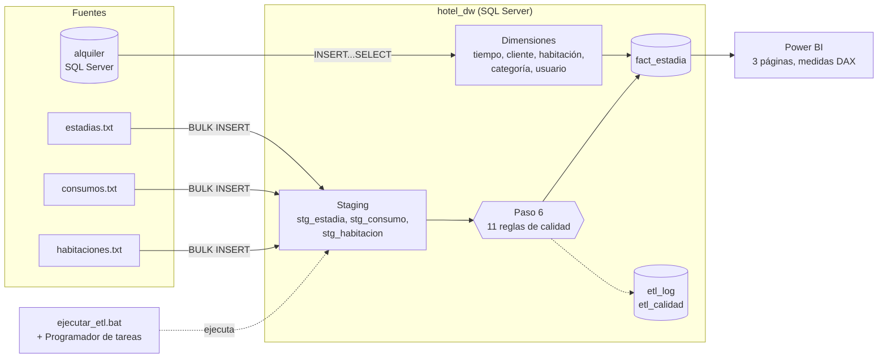
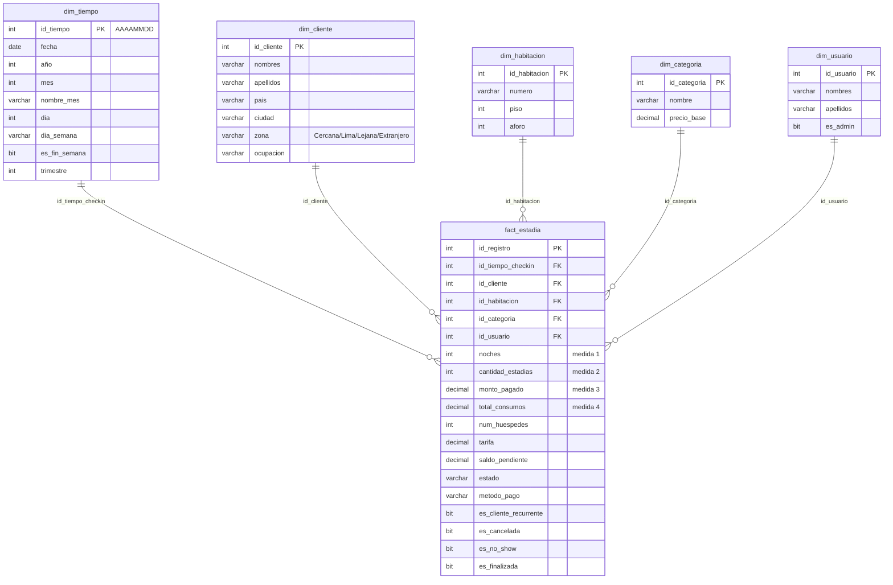

# Solución de Inteligencia de Negocios — Tunki Lodge

**Factores asociados a la no-llegada de huéspedes en el sistema Estadía de Tunki Lodge**


Este repositorio contiene una solución completa de Inteligencia de Negocios construida sobre **Estadía**, el sistema web de gestión de estadías de Tunki Lodge (Oxapampa, Pasco): la base operativa, un **datamart en esquema estrella**, un **proceso ETL automatizado con reglas de calidad de datos y control de errores**, un **dashboard en Power BI** y la documentación del proyecto (informe técnico, presentación y procedimiento de replicación).

---

## Índice

1. [Resumen ejecutivo](#1-resumen-ejecutivo)
2. [Problema de negocio](#2-problema-de-negocio)
3. [Indicadores (KPIs)](#3-indicadores-kpis)
4. [Arquitectura de la solución](#4-arquitectura-de-la-solución)
5. [Estructura del repositorio](#5-estructura-del-repositorio)
6. [Datos de origen](#6-datos-de-origen)
7. [Modelo dimensional (datamart `hotel_dw`)](#7-modelo-dimensional-datamart-hotel_dw)
8. [Proceso ETL](#8-proceso-etl)
9. [Calidad de datos](#9-calidad-de-datos)
10. [Control de errores y bitácora](#10-control-de-errores-y-bitácora)
11. [Automatización](#11-automatización)
12. [Dashboard en Power BI](#12-dashboard-en-power-bi)
13. [Resultados](#13-resultados)
14. [Experimentación](#14-experimentación)
15. [Cómo replicar el proyecto paso a paso](#15-cómo-replicar-el-proyecto-paso-a-paso)
16. [Verificación](#16-verificación)
17. [Solución de problemas](#17-solución-de-problemas)
18. [Sistema fuente: aplicación Estadía](#18-sistema-fuente-aplicación-estadía)
19. [Decisiones técnicas](#19-decisiones-técnicas)
20. [Limitaciones y trabajos futuros](#20-limitaciones-y-trabajos-futuros)
21. [Documentación y evidencias](#21-documentación-y-evidencias)
22. [Equipo](#22-equipo)

---

## 1. Resumen ejecutivo

| | |
|---|---|
| **Empresa** | Tunki Lodge — Oxapampa, Pasco (Perú). 45 habitaciones en 6 categorías |
| **Problema** | Las reservas caen en 2026 y la no-llegada de huéspedes (cancelación + no-show) aumenta, sin que el negocio sepa por qué |
| **Solución** | Datamart en esquema estrella + ETL automatizado con calidad de datos + dashboard en Power BI |
| **Periodo analizado** | Enero de 2024 a octubre de 2026 (fecha de corte: 23/10/2026) |
| **Volumen** | 9 036 estadías, 6 594 clientes, 7 096 consumos |
| **Hallazgo principal** | La no-llegada es **3 veces mayor** en clientes de ciudades lejanas (15.2 %) que en los de ciudades cercanas a Oxapampa (4.5 %), y **2 veces mayor** con pago en efectivo (13.5 %) que con transferencia (6.8 %). En 2026 esos segmentos ganaron participación |
| **Recomendación** | Ofertas dirigidas (prepago, mercado cercano, fidelidad, adelanto en categorías grandes) en lugar de descuentos generales |

> **Datos simulados.** Las estadías, clientes y consumos del periodo 2024–2026 son **datos simulados con fines de análisis**, generados con reglas que reproducen la estacionalidad del hotel y asignan a cada reserva un riesgo de no-llegada según sus características. Las categorías, habitaciones, productos y usuarios son los del sistema. Los resultados muestran la capacidad de la solución para detectar estos patrones; no son una medición de la operación real del hotel.

---

## 2. Problema de negocio

En 2024 el hotel registró 3 346 reservas y en 2025 creció a 3 511 (+4.9 %), con la temporada alta habitual en enero–marzo, julio y diciembre y una tasa de cancelación estable de **5 %**. En 2026 la tendencia se invierte:

| Indicador (enero–octubre) | 2025 | 2026 | Variación |
|---|---|---|---|
| Reservas | 2 909 | 2 179 | **−25.1 %** |
| Ingreso cobrado | S/ 1 885 999 | S/ 1 315 500 | **−30.2 %** |
| Tasa de cancelación | 5.0 % | 10.0 % | 5.1 % en enero → 19.2 % en septiembre |

Cada mes de 2026 queda por debajo del mismo mes de 2025, desde −7.5 % en enero hasta −58.8 % en octubre.

**Pregunta de negocio:** ¿por qué caen las reservas y en qué segmentos se concentra la no-llegada de huéspedes?

El sistema Estadía registra cada reserva, pero no consolida la información en el tiempo ni la compara por segmento, y no aplica controles de calidad sobre los datos que se analizan. Por eso se necesita una solución de BI: integrar las fuentes en un modelo dimensional centrado en el tiempo, con un proceso de carga confiable y automatizado, y presentar los resultados en un tablero que apoye decisiones comerciales.

**Variables analizadas:** zona de origen del cliente, método de pago, categoría de habitación, tamaño del grupo y cliente nuevo o recurrente.

> El sistema no guarda la fecha en que se hizo la reserva, por lo que la **anticipación** de la reserva no se puede medir con los datos disponibles (ver [Limitaciones](#20-limitaciones-y-trabajos-futuros)).

---

## 3. Indicadores (KPIs)

| KPI | Fórmula | Granularidad y filtros | Decisión que apoya | Medida DAX |
|---|---|---|---|---|
| **Variación interanual de reservas** | (reservas del mes − reservas del mismo mes del año anterior) / reservas del mismo mes del año anterior × 100 | Mes y año del check-in | Cuándo y cuánto actuar | `Var. interanual reservas` |
| **Tasa de cancelación** | estadías canceladas / total de estadías × 100 | Mes, zona, método de pago, categoría, tipo de cliente | Dónde exigir adelanto | `% Cancelación` |
| **Tasa de no-show** | estadías no-show / total de estadías × 100 | Mes, zona, método de pago, categoría | Dónde reforzar la confirmación | `% No-show` |
| **Ingreso por estadía** | monto pagado / estadías finalizadas | Mes y categoría | Valor real de cada huésped que llega | `Ingreso por estadía (S/)` |

- **Frecuencia de actualización:** cada ejecución del ETL (programado todos los días a las 23:00).
- **Fuente:** `hotel_dw.fact_estadia` unida a sus dimensiones.
- **No-llegada** = cancelación + no-show (medida `% No-llegada`).

---

## 4. Arquitectura de la solución



| Capa | Componente | Tecnología |
|---|---|---|
| Sistema fuente (OLTP) | Aplicación Estadía + base `alquiler` | Spring Boot 3.1.4, Java 17, SQL Server 2025 |
| Fuentes planas | `estadias.txt`, `consumos.txt`, `habitaciones.txt` | Archivos de texto (UTF-8, CRLF) |
| Integración | ETL de 8 pasos con staging, calidad y bitácora | T-SQL (`BULK INSERT`, `INSERT…SELECT`, `TRY/CATCH`) |
| Almacén | Datamart `hotel_dw` en esquema estrella | SQL Server 2025 |
| Automatización | `ejecutar_etl.bat` + tarea programada | `sqlcmd` + Programador de tareas de Windows |
| Visualización | Dashboard interactivo | Power BI Desktop (proyecto `.pbip`, medidas DAX) |

---

## 5. Estructura del repositorio

```
proyecto-bi-bigdata/
├── bd/
│   └── respaldo_bd_actual.sql        # Crea la base operativa alquiler con todos sus datos (2024–2026)
├── bi/
│   ├── crear_datamart.sql            # Crea hotel_dw: modelo estrella, staging, etl_log y etl_calidad
│   ├── ETL_CARGA.sql                 # ETL de 8 pasos con calidad de datos, TRY/CATCH y bitácora
│   ├── ejecutar_etl.bat              # Ejecuta el ETL con sqlcmd (sin abrir SSMS)
│   ├── programar_etl.bat             # Programa el ETL todos los días a las 23:00
│   ├── fuentes/
│   │   ├── estadias.txt              # 9 036 estadías (separador |)
│   │   ├── consumos.txt              # 7 096 consumos (separador |)
│   │   └── habitaciones.txt          # 45 habitaciones (separador ,)
│   └── powerbi/
│       ├── TunkiLodge_BI.pbip        # Abrir este archivo en Power BI Desktop
│       ├── TunkiLodge_BI.Report/     # Páginas y visuales del reporte (formato PBIR)
│       └── TunkiLodge_BI.SemanticModel/  # Modelo: tablas, relaciones y medidas DAX (formato TMDL)
├── docs/
│   ├── Informe_Proyecto_Final_Grupo04.docx / .pdf     # Informe técnico (8 capítulos)
│   ├── Presentacion_BI_Grupo04.pptx                   # Presentación (5 minutos)
│   └── Procedimiento_Replicacion_Grupo04.docx / .pdf  # Manual paso a paso
├── src/                              # Aplicación Estadía (sistema fuente)
├── scripts/crear-usuario.sh          # Genera un usuario con contraseña cifrada (BCrypt)
├── .github/workflows/tests.yml       # Integración continua de la aplicación
├── pom.xml, mvnw, mvnw.cmd           # Construcción de la aplicación (Maven)
└── README.md
```

---

## 6. Datos de origen

### Base operativa `alquiler` (SQL Server)

Se crea completa con [`bd/respaldo_bd_actual.sql`](bd/respaldo_bd_actual.sql): borra la base si existe, la vuelve a crear y, por cada tabla, ejecuta su `CREATE TABLE` seguido de sus `INSERT`. El archivo está en ANSI (Windows-1252) para que SSMS lea bien las tildes y la ñ.

| Tabla | Filas | Contenido |
|---|---|---|
| `registro` | 9 036 | Estadías: check-in, noches, huéspedes, tarifa, estado, método de pago, monto pagado |
| `cliente` | 6 594 | Huéspedes: nombre, documento, país, ciudad, ocupación |
| `consumo` | 7 096 | Consumos adicionales durante la estadía (minibar, room service, lavandería…) |
| `habitacion` | 45 | Número, piso, aforo, categoría y estado |
| `categoria` | 6 | De la Habitación Matrimonial (S/ 180) a la Cabaña Bungalow (S/ 450) |
| `usuario` | 9 | Personal de recepción y administración (contraseñas con BCrypt) |
| `producto_consumo` | 5 | Catálogo de productos de consumo |
| `login_attempts`, `reserva`, `comprobante`, `password_reset_token` | — | Tablas de seguridad y operación de la aplicación |

**Estados de una estadía:** `ACTIVA`, `FINALIZADA`, `CANCELADA`, `NO_SHOW`. La no-llegada agrupa `CANCELADA` y `NO_SHOW`.

### Archivos planos (`bi/fuentes/`)

| Archivo | Separador | Cabecera | Columnas |
|---|---|---|---|
| `estadias.txt` | `\|` | Sí | id, check_in, estado, cliente_id, habitacion_id, usuario_id, noches, num_huespedes, tarifa, monto_pagado, metodo_pago |
| `consumos.txt` | `\|` | Sí | id, registro_id, descripcion, monto, fecha |
| `habitaciones.txt` | `,` | No | id, numero, piso, aforo, categoria_id |

Los tres se guardan en **UTF-8 con fin de línea de Windows (CRLF)**, requisito de `BULK INSERT` con `ROWTERMINATOR = '\n'`, y se copian a `C:\txt\tunki\` antes de ejecutar el ETL.

---

## 7. Modelo dimensional (datamart `hotel_dw`)

Esquema estrella con **5 dimensiones** conectadas directamente a una **tabla de hechos** con **4 medidas**. Grano: **una fila por estadía**.



| Elemento | Detalle |
|---|---|
| **Dimensiones (5)** | `dim_tiempo` (1 035 días, 01/01/2024–31/10/2026), `dim_cliente` (6 594), `dim_habitacion` (45), `dim_categoria` (6), `dim_usuario` (9) |
| **Medidas (4)** | `noches`, `cantidad_estadias`, `monto_pagado`, `total_consumos` |
| **Integridad referencial** | `PRIMARY KEY` en cada tabla y 5 `FOREIGN KEY` de `fact_estadia` hacia cada dimensión |
| **Atributo calculado** | `zona` de origen del cliente, a partir de la ciudad y el país |
| **Decisión de diseño** | `dim_categoria` se conecta directo a los hechos (no a través de la habitación) para mantener un esquema estrella y evitar un copo de nieve |
| **Tablas de apoyo** | 3 tablas de staging; `etl_log` (bitácora del ETL) y `etl_calidad` (reglas de calidad) |

Definición completa: [`bi/crear_datamart.sql`](bi/crear_datamart.sql).

---

## 8. Proceso ETL

[`bi/ETL_CARGA.sql`](bi/ETL_CARGA.sql) carga todo el datamart en **8 pasos** y en una sola corrida. Es **idempotente**: el paso 1 vacía hechos, dimensiones y staging, por lo que se puede ejecutar las veces que se quiera sin duplicar datos (las bitácoras conservan el historial).

| Paso | Fuente | Transformación | Destino |
|---|---|---|---|
| **1. Limpieza** | — | `DELETE` de hechos y dimensiones; `TRUNCATE` de staging | Todas las tablas (salvo bitácoras) |
| **2. Dimensiones** | `alquiler` (categoria, cliente, usuario) | `INSERT … SELECT` entre bases; zona de origen con `CASE` según ciudad y país | `dim_categoria`, `dim_cliente`, `dim_usuario` |
| **3. Estadías** | `estadias.txt` | `BULK INSERT` dinámico dentro de `TRY/CATCH` | `stg_estadia` |
| **4. Consumos** | `consumos.txt` | `BULK INSERT` dinámico dentro de `TRY/CATCH` | `stg_consumo` |
| **5. Habitaciones** | `habitaciones.txt` | `BULK INSERT` y carga de la dimensión | `stg_habitacion`, `dim_habitacion` |
| **6. Calidad de datos** | Staging | 11 reglas que corrigen o descartan registros y registran el resultado | `etl_calidad` |
| **7. Tiempo** | Fechas de check-in | `WHILE` día por día; `DATEPART` para año, mes, día, día de la semana y trimestre | `dim_tiempo` |
| **8. Hechos** | Staging + dimensiones | Suma de consumos por estadía, saldo pendiente, banderas de estado, cliente recurrente (`EXISTS`) | `fact_estadia` |

**Clasificación de la zona de origen:**

| Zona | Regla |
|---|---|
| Extranjero | `pais <> 'Perú'` |
| Lima | `ciudad = 'Lima'` |
| Cercana | Huancayo, La Merced, Huánuco, Cerro de Pasco, Tarma, Oxapampa |
| Lejana | Cualquier otra ciudad del Perú |

**Funciones de SQL Server utilizadas:** `DATEPART`, `DATEADD`, `CAST`, `MIN`, `MAX`, `SUM`, `COUNT`, `CASE`, `EXISTS`, `BULK INSERT`, `WHILE`, `GETDATE`. Para el control de errores y la medición del consumo se agregan `ERROR_MESSAGE`, `DATEDIFF` y la vista del sistema `sys.dm_exec_sessions`.

**Ejemplo — carga de un archivo con control de errores (paso 3):**

```sql
BEGIN TRY
    DECLARE @ARCHIVO VARCHAR(100), @sql VARCHAR(MAX)
    SET @ARCHIVO = 'C:\txt\tunki\estadias.txt'
    SET @sql = 'BULK INSERT hotel_dw.dbo.stg_estadia FROM ''' + @ARCHIVO + ''' WITH (FIRSTROW = 2, FIELDTERMINATOR = ''|'', ROWTERMINATOR = ''\n'', CODEPAGE = ''65001'')'
    EXEC(@sql)
END TRY
BEGIN CATCH
    UPDATE hotel_dw.dbo.etl_log
    SET estado = 'ERROR', mensaje = LEFT(ERROR_MESSAGE(), 400)
    WHERE id = (SELECT MAX(id) FROM hotel_dw.dbo.etl_log)
END CATCH
```

---

## 9. Calidad de datos

La calidad se aplica **en tres niveles**:

1. **Reglas sobre el staging (paso 6)**, antes de cargar la tabla de hechos. Cada regla cuenta los registros afectados, los registra en `etl_calidad` y los corrige o descarta.
2. **Integridad referencial:** las claves foráneas del datamart impiden cargar un hecho sin su dimensión.
3. **Reconciliación final:** al terminar, el ETL compara estadías y consumos entre el origen (`alquiler`) y el destino (`hotel_dw`).

| Regla | Qué controla | Tabla | Acción |
|---|---|---|---|
| **R01** | Filas de estadía repetidas exactamente | `stg_estadia` | Se conserva una sola copia |
| **R01B** | Mismo id con datos distintos | `stg_estadia` | Se descartan (no se sabe cuál es la correcta) |
| **R02** | Estadía sin id o sin fecha de check-in | `stg_estadia` | Se descarta |
| **R03** | Estado distinto de ACTIVA, FINALIZADA, CANCELADA o NO_SHOW | `stg_estadia` | Se descarta |
| **R04** | Noches o huéspedes en cero o negativos | `stg_estadia` | Se descarta |
| **R05** | Tarifa nula o negativa | `stg_estadia` | Se descarta |
| **R06** | Monto pagado nulo | `stg_estadia` | Se corrige a 0 |
| **R07** | Método de pago vacío | `stg_estadia` | Se corrige a `NO_REGISTRADO` |
| **R08** | Cliente, habitación o usuario inexistente | `stg_estadia` | Se descarta |
| **R09** | Consumo sin estadía válida (huérfano) | `stg_consumo` | Se descarta |
| **R10** | Consumo con monto nulo o no positivo | `stg_consumo` | Se descarta |

**Ejemplo de una regla:**

```sql
-- R03: Estado no válido
INSERT INTO etl_calidad (ejecucion, regla, descripcion, tabla, registros_afectados, accion, fecha)
SELECT (SELECT MAX(ejecucion) FROM etl_log), 'R03', 'Estado no válido', 'stg_estadia', COUNT(*), 'Registro descartado', GETDATE()
FROM stg_estadia
WHERE estado IS NULL OR estado NOT IN ('ACTIVA', 'FINALIZADA', 'CANCELADA', 'NO_SHOW')

DELETE FROM stg_estadia
WHERE estado IS NULL OR estado NOT IN ('ACTIVA', 'FINALIZADA', 'CANCELADA', 'NO_SHOW')
```

**Cómo probarlo:** agregue al final de `C:\txt\tunki\estadias.txt` una línea con un estado inválido, por ejemplo `99001|2026-05-10 14:00:00|PERDIDA|164|21|15|2|2|360.00|0.00|EFECTIVO`, ejecute el ETL y consulte `SELECT * FROM hotel_dw.dbo.etl_calidad`: la regla R03 muestra 1 registro descartado.

---

## 10. Control de errores y bitácora

**Bitácora `etl_log`:** cada paso registra al inicio y al final la hora y los contadores de la sesión (`sys.dm_exec_sessions`); la diferencia es lo que consumió el paso.

| Columna | Significado |
|---|---|
| `ejecucion` | Número de ejecución del ETL (1, 2, 3…) |
| `paso` | Nombre del paso |
| `estado` | `OK` o `ERROR` |
| `duracion_ms` | Tiempo total del paso |
| `cpu_ms` | Tiempo de CPU del paso |
| `lecturas_logicas` | Páginas de 8 KB leídas |
| `filas` | Filas cargadas (o registros afectados por las reglas, en el paso 6) |
| `mensaje` | Mensaje del motor si el paso falló |

**Control de errores:** las cargas de archivos y de la tabla de hechos están dentro de `TRY/CATCH`. Si un paso falla (por ejemplo, falta un archivo), queda como `ERROR` en `etl_log` con el mensaje de SQL Server y **el resto del proceso continúa**. Los archivos se cargan con SQL dinámico (`EXEC`), lo que permite capturar también el error de archivo inexistente.

```sql
SELECT ejecucion, paso, estado, duracion_ms, cpu_ms, filas, mensaje
FROM hotel_dw.dbo.etl_log
ORDER BY id;
```

---

## 11. Automatización

| Archivo | Qué hace |
|---|---|
| [`bi/ejecutar_etl.bat`](bi/ejecutar_etl.bat) | Ejecuta `ETL_CARGA.sql` con `sqlcmd` y autenticación de Windows (`-E`, sin contraseñas). Guarda la salida en `bi/logs/ultima_ejecucion.log` |
| [`bi/programar_etl.bat`](bi/programar_etl.bat) | Crea la tarea **"ETL hotel_dw"** en el Programador de tareas de Windows, que ejecuta el `.bat` anterior **todos los días a las 23:00** |

```
23:00 → Programador de tareas → ejecutar_etl.bat → sqlcmd → ETL_CARGA.sql
                                                              ↓
              hotel_dw actualizado + etl_log (estado, tiempo, CPU) + etl_calidad
                                                              ↓
                                     Power BI → Actualizar → dashboard al día
```

Comandos útiles:

```bat
:: Programar el ETL (una sola vez)
bi\programar_etl.bat

:: Ejecutar la tarea en este momento
schtasks /run /tn "ETL hotel_dw"

:: Ver la tarea
schtasks /query /tn "ETL hotel_dw"

:: Quitar la programación
schtasks /delete /tn "ETL hotel_dw" /f
```

> Se eligió el Programador de tareas porque no requiere permisos de administrador ni servicios adicionales. En un servidor de producción, el mismo comando puede programarse como un **job de SQL Server Agent**.

---

## 12. Dashboard en Power BI

Proyecto: [`bi/powerbi/TunkiLodge_BI.pbip`](bi/powerbi/TunkiLodge_BI.pbip), en formato de proyecto de Power BI (texto versionable: el reporte en PBIR y el modelo en TMDL). Se conecta a `hotel_dw` en modo importación.

### Modelo

- Replica el esquema estrella (5 dimensiones + `fact_estadia`) con sus relaciones; incluye además `etl_log` y `etl_calidad`.
- `dim_tiempo` está marcada como **tabla de fechas** (habilita la inteligencia de tiempo de DAX).
- `nombre_mes` se ordena por `mes`.
- **Columnas calculadas:** `tipo_cliente` (Nuevo / Recurrente) y `tamaño_grupo` (1 a 4 / 5 o más huéspedes).

### Medidas DAX

| Carpeta | Medida | Expresión |
|---|---|---|
| Medidas base | `Reservas` | `SUM(fact_estadia[cantidad_estadias])` |
| Medidas base | `Noches vendidas` | `SUM(fact_estadia[noches])` |
| Medidas base | `Ingreso (S/)` | `SUM(fact_estadia[monto_pagado])` |
| Medidas base | `Consumos (S/)` | `SUM(fact_estadia[total_consumos])` |
| Medidas base | `Canceladas`, `No-show`, `Finalizadas` | `CALCULATE([Reservas], fact_estadia[es_…] = TRUE())` |
| KPIs | `% Cancelación` | `DIVIDE([Canceladas], [Reservas])` |
| KPIs | `% No-show` | `DIVIDE([No-show], [Reservas])` |
| KPIs | `% No-llegada` | `DIVIDE([Canceladas] + [No-show], [Reservas])` |
| KPIs | `Ingreso por estadía (S/)` | `DIVIDE([Ingreso (S/)], [Finalizadas])` |
| KPIs | `Reservas año anterior` | `CALCULATE([Reservas], SAMEPERIODLASTYEAR(dim_tiempo[fecha]))` |
| KPIs | `Var. interanual reservas` | `IF(HASONEVALUE(dim_tiempo[año]), DIVIDE([Reservas] - [Reservas año anterior], [Reservas año anterior]))` |
| KPIs | `Ingreso año anterior (S/)`, `Var. interanual ingreso` | Igual que las anteriores, sobre el ingreso |

### Páginas

| Página | Contenido | Decisión que apoya |
|---|---|---|
| **1. Resumen ejecutivo** | Tarjetas: reservas, variación interanual, % cancelación, % no-show, ingreso por estadía. Líneas: reservas y tasa de cancelación por mes, una línea por año | Cuándo y cuánto cayó el negocio |
| **2. Factores de no-llegada** | % no-llegada por zona de origen, método de pago, categoría, tipo de cliente y tamaño del grupo | A quién dirigir ofertas y dónde exigir adelanto |
| **3. Comparación interanual** | Reservas e ingresos frente al mismo mes del año anterior; tabla mensual con variación y % cancelación | Magnitud de la caída de 2026 frente a 2025 |

Todas las páginas tienen un **filtro de año** y **filtrado cruzado** entre visuales (al hacer clic en una barra se filtran los demás gráficos). Las variaciones interanuales se muestran al elegir un año (por ejemplo, 2026).

---

## 13. Resultados

### Caída de 2026

| Mes | 2025 | 2026 | Variación | % cancelación 2026 |
|---|---|---|---|---|
| Enero | 361 | 334 | −7.5 % | 5.1 % |
| Febrero | 354 | 317 | −10.5 % | 6.0 % |
| Marzo | 301 | 280 | −7.0 % | 7.1 % |
| Abril | 271 | 250 | −7.7 % | 8.4 % |
| Mayo | 259 | 225 | −13.1 % | 10.2 % |
| Junio | 242 | 200 | −17.4 % | 12.0 % |
| Julio | 333 | 180 | −45.9 % | 13.9 % |
| Agosto | 277 | 155 | −44.0 % | 16.8 % |
| Septiembre | 249 | 130 | −47.8 % | 19.2 % |
| Octubre* | 262 | 108 | −58.8 % | 15.7 % |
| **Total** | **2 909** | **2 179** | **−25.1 %** | **10.0 %** |

\* Octubre de 2026 es un mes incompleto (fecha de corte 23/10/2026) e incluye reservas futuras.

### Factores de no-llegada (llegadas hasta el 23/10/2026)

| Factor | Mayor no-llegada | Menor no-llegada | Brecha |
|---|---|---|---|
| Zona de origen | Lejana 15.2 % (Extranjero 14.6 %) | Cercana a Oxapampa 4.5 % (Lima 8.6 %) | **10.7 pp** |
| Método de pago | Efectivo 13.5 % | Transferencia 6.8 % (Tarjeta 8.3 %) | 6.7 pp |
| Categoría | Cabaña Bungalow 15.9 % (Domo Colibrí 14.3 %) | Habitación Matrimonial 7.0 % | 8.9 pp |
| Tamaño del grupo | 5 o más huéspedes 13.5 % | 1 a 4 huéspedes 8.8 % | 4.7 pp |
| Tipo de cliente | Nuevo 10.7 % | Recurrente 6.6 % | 4.1 pp |
| Solo 2026: zona y pago | Lejana 21.5 %; Efectivo 19.8 % | Cercana 6.9 %; Transferencia 7.7 % | 14.6 pp; 12.1 pp |

Además, en 2026 creció la participación de los segmentos de mayor riesgo: el pago en efectivo pasó de **29.4 % a 43.5 %** de las reservas y los clientes de zonas lejanas de **25.9 % a 34.2 %**.

> Es una **asociación** observada en los datos, no una relación causal demostrada.

### Recomendaciones

1. **Prepago:** descuento al pagar con tarjeta o transferencia al momento de reservar.
2. **Mercado cercano:** campañas en Huancayo, La Merced y Huánuco, el segmento más confiable.
3. **Fidelidad:** beneficios para clientes recurrentes.
4. **Adelanto obligatorio** en Cabaña, Domo y grupos de 5 o más.
5. **Sistema:** registrar la fecha y el canal de la reserva para medir la anticipación.

---

## 14. Experimentación

**Pregunta principal:** ¿qué características de la reserva están asociadas a la no-llegada de huéspedes, y explica su evolución la caída de reservas de 2026 frente a 2024–2025?

| Experimento | Hipótesis | Resultado |
|---|---|---|
| **EXP-01 (principal, negocio)** | La no-llegada difiere ≥ 10 pp entre segmentos y en 2026 crecen los segmentos de mayor riesgo | ✅ 10.7 pp por zona (14.6 pp en 2026); el efectivo sube de 29 % a 44 % |
| **EXP-02 (rendimiento)** | El ETL crece de forma casi lineal y tarda menos de 5 s con 15 000 estadías | ✅ 3.46 s con 15 000 estadías |
| **EXP-03 (calidad)** | Las reglas detectan el 100 % de los registros defectuosos | ✅ 14 de 14 detectados; un archivo faltante queda como ERROR sin detener el ETL |
| **EXP-04 (exactitud)** | Los indicadores coinciden entre SQL y Power BI | ✅ Diferencia 0 |

**EXP-02 — rendimiento del ETL por volumen** (media de 3 repeticiones):

| Lote | Duración | CPU | Paso 6 (calidad) | Paso 8 (hechos) | Filas/s |
|---|---|---|---|---|---|
| 500 | 0.67 s | 0.53 s | 0.25 s | 0.14 s | ≈ 745 |
| 1 500 | 0.93 s | 0.75 s | 0.37 s | 0.17 s | ≈ 1 610 |
| 3 000 | 1.43 s | 1.18 s | 0.51 s | 0.23 s | ≈ 2 100 |
| 5 000 | 2.52 s | 2.30 s | 0.73 s | 0.32 s | ≈ 1 980 |
| 8 000 | 2.69 s | 2.35 s | 1.15 s | 0.42 s | ≈ 2 980 |
| 9 036 | 2.44 s | 2.08 s | 1.16 s | 0.48 s | ≈ 3 700 |
| 15 000 | 3.46 s | 3.16 s | 1.80 s | 0.79 s | ≈ 4 340 |

Al multiplicar el volumen por 30 (de 500 a 15 000) la duración solo se multiplica por 5, porque hay un costo fijo de alrededor de medio segundo. El paso más costoso es la calidad de datos; reemplazar `NOT IN` por `NOT EXISTS` en sus reglas redujo ese paso de 21.7 s a 1.2 s (−94 %).

Entorno de las pruebas: AMD Ryzen 7 7730U (8 núcleos), 32 GB de RAM, Windows 11, SQL Server 2025 Developer.

---

## 15. Cómo replicar el proyecto paso a paso

> **Manual completo de instalación y ejecución:** [`docs/Procedimiento_Replicacion_Grupo04.pdf`](docs/Procedimiento_Replicacion_Grupo04.pdf). Cubre desde la instalación de SQL Server (modo mixto, TCP/IP en el puerto 1433), SSMS, Java y Power BI hasta la ejecución de la aplicación, el ETL, su automatización y el dashboard, con el resultado esperado en cada paso, una lista de comprobación, la solución de errores frecuentes y el guion de la demostración. Se probó de principio a fin a partir de una copia del proyecto descargada como ZIP.
>
> Resumen de los pasos:

### Requisitos

| Componente | Versión |
|---|---|
| Windows | 10 u 11 |
| SQL Server | 2025 (Developer o Express), instancia local, puerto 1433 |
| SQL Server Management Studio | 22 (la versión 20 no permite diagramas en SQL Server 2025) |
| sqlcmd | Incluido con SQL Server |
| Power BI Desktop | Versión reciente (2.15x o superior) |
| Java 17 | Solo para ejecutar la aplicación Estadía |

### Pasos

**1. Obtener el proyecto**

```bash
git clone https://github.com/AlexAmancio/proyecto-bi-bigdata.git
```

**2. Crear la base operativa** — en SSMS 22: *File → Open → File…* → [`bd/respaldo_bd_actual.sql`](bd/respaldo_bd_actual.sql) → **F5**. Al final debe mostrar `registro 9036`, `cliente 6594`, `consumo 7096`.

**3. Copiar los archivos planos** — crear la carpeta `C:\txt\tunki\` y copiar en ella los tres archivos de [`bi/fuentes/`](bi/fuentes).

**4. Crear el datamart** — abrir [`bi/crear_datamart.sql`](bi/crear_datamart.sql) → **F5**.

**5. Ejecutar el ETL** — abrir [`bi/ETL_CARGA.sql`](bi/ETL_CARGA.sql) → **F5**, o doble clic en [`bi/ejecutar_etl.bat`](bi/ejecutar_etl.bat).

**6. Programar el ETL (opcional)** — doble clic en [`bi/programar_etl.bat`](bi/programar_etl.bat).

**7. Abrir el dashboard** — doble clic en [`bi/powerbi/TunkiLodge_BI.pbip`](bi/powerbi/TunkiLodge_BI.pbip) → **Actualizar**. Si pide credenciales: **Windows → Usar mis credenciales actuales → Conectar**. Si aparece "Compatibilidad con cifrado": **Aceptar** (conexión local). Guardar con **Ctrl + S**.

---

## 16. Verificación

Resultados esperados al final de `ETL_CARGA.sql`:

| Comprobación | Valor esperado |
|---|---|
| Estadías origen / destino | 9 036 / 9 036 |
| Consumos origen / destino | S/ 200 014 / S/ 200 014 |
| Pasos del ETL | 8 en estado `OK` |
| Reglas de calidad registradas | 11 |
| `dim_tiempo` | 1 035 días |

Consultas útiles:

```sql
USE hotel_dw;

-- Origen = destino
SELECT (SELECT COUNT(*) FROM alquiler.dbo.registro) AS estadias_origen,
       (SELECT COUNT(*) FROM fact_estadia)          AS estadias_destino;

-- Estado y consumo de cada paso del ETL
SELECT ejecucion, paso, estado, duracion_ms, cpu_ms, filas FROM etl_log ORDER BY id;

-- Reglas de calidad aplicadas en la última ejecución
SELECT regla, descripcion, registros_afectados, accion
FROM etl_calidad WHERE ejecucion = (SELECT MAX(ejecucion) FROM etl_log);

-- Tasa de no-llegada por zona de origen
SELECT C.zona, COUNT(*) AS reservas,
       CAST(100.0 * SUM(CAST(F.es_cancelada AS INT) + CAST(F.es_no_show AS INT)) / COUNT(*) AS DECIMAL(5,1)) AS pct_no_llegada
FROM fact_estadia F JOIN dim_cliente C ON C.id_cliente = F.id_cliente
WHERE F.id_tiempo_checkin <= 20261023
GROUP BY C.zona ORDER BY pct_no_llegada DESC;
```

---

## 17. Solución de problemas

| Problema | Causa | Solución |
|---|---|---|
| `Cannot drop database because it is currently in use` | Hay pestañas de SSMS conectadas a la base | Cerrarlas y volver a ejecutar |
| `Cannot bulk load… file does not exist` | Faltan los archivos en `C:\txt\tunki\` | Copiar los 3 archivos de `bi/fuentes/` |
| `Incorrect syntax near…` en la línea 1 | El script se copió desde el navegador con caracteres invisibles | Abrirlo con *File → Open* |
| `Esta versión de backend no admite el diseño` | SSMS 20 no es compatible con SQL Server 2025 para diagramas | Usar SSMS 22 |
| Power BI muestra "(En blanco)" | Los datos no se han actualizado, o no hay un año elegido en las variaciones | Pulsar **Actualizar**; elegir un año en el filtro |
| `Login failed` en Power BI o en el `.bat` | El usuario de Windows no tiene acceso a SQL Server | Dar acceso al usuario o usar una cuenta con permisos |

---

## 18. Sistema fuente: aplicación Estadía

La base `alquiler` es la base operativa de **Estadía**, una aplicación web desarrollada con Spring Boot que cubre todo el ciclo de una estadía.

### Funcionalidades

- **Check-in / check-out** con cálculo automático de tarifa, noches y saldo pendiente; tarifa de temporada alta por categoría.
- **Reservas múltiples:** una reserva puede cubrir varias habitaciones, validando aforo y solapamiento de fechas por cada una, dentro de una sola transacción.
- **Extensión de estadía**, cancelación y no-show.
- Gestión de **clientes, habitaciones, categorías y consumos**; autocompletado de datos por DNI.
- **Calendario de ocupación**, **reportes** del día y **búsqueda global**.
- **Comprobantes internos** con correlativo e IGV desglosado (demostración, no válidos ante SUNAT).
- **Usuarios con roles** (administrador / recepción), bloqueo temporal por intentos fallidos de inicio de sesión y una sola sesión por usuario.

### Tecnologías

| Capa | Tecnología |
|---|---|
| Lenguaje | Java 17 |
| Framework | Spring Boot 3.1.4 (Spring MVC, Spring Data JPA, Spring Security 6) |
| Vistas | Thymeleaf |
| Base de datos | SQL Server (controlador `mssql-jdbc`) |

Arquitectura en capas: **Controller → Service → Repository (Spring Data JPA) → SQL Server**. `Habitacion` y `Registro` usan bloqueo optimista (`@Version`) para evitar que dos usuarios sobrescriban los mismos datos.

### Ejecutar la aplicación

La aplicación se conecta a `localhost:1433` con el usuario `sa` (o el de `DB_USER`) y la contraseña de la variable de entorno `DB_PASSWORD`, que **nunca se guarda en el código**.

```powershell
$env:DB_PASSWORD = '<contraseña de sa>'
.\mvnw.cmd spring-boot:run
```

Queda disponible en `http://localhost:8992`. Usuario de prueba incluido en el script de la base: **`elon` / `admin123`** (administrador).

### Pruebas e integración continua

```bash
./mvnw test
```

Pruebas unitarias (con y sin Mockito) y de integración (MockMvc contra SQL Server). Cada push y pull request ejecuta el pipeline [`tests.yml`](.github/workflows/tests.yml) en GitHub Actions.

---

## 19. Decisiones técnicas

| Decisión | Alternativa descartada | Motivo |
|---|---|---|
| Datamart en la misma instancia de SQL Server que la base operativa | Motor separado | Permite `INSERT … SELECT` entre bases y `BULK INSERT` sin herramientas intermedias |
| ETL en scripts T-SQL | SSIS | Más fácil de versionar, revisar y reproducir; el volumen no justifica SSIS |
| `dim_categoria` conectada directo a los hechos | Categoría colgando de la habitación | Mantiene un esquema estrella (sin copo de nieve) |
| Staging sin llave primaria | PK en staging | Los duplicados se tratan como regla de calidad y no como error de carga |
| `NOT EXISTS` en las reglas de calidad | `NOT IN` | Reduce el paso de calidad de 21.7 s a 1.2 s |
| `BULK INSERT` con SQL dinámico | `BULK INSERT` directo | Permite que `TRY/CATCH` capture un archivo inexistente |
| Programador de tareas + `sqlcmd` | SQL Server Agent | No requiere permisos de administrador ni servicios adicionales |
| Power BI en formato `.pbip` | `.pbix` binario | Formato de texto versionable en Git |
| Funciones estándar de T-SQL | `ISNULL`, `CONVERT`, `ROW_NUMBER` | Se usan `CASE`, `DATEPART` y `EXISTS` para mantener un conjunto reducido y explicable |

---

## 20. Limitaciones y trabajos futuros

**Limitaciones**

- Los datos de estadías, clientes y consumos son **simulados**; los patrones provienen de reglas definidas por el equipo.
- El sistema no registra la **fecha de la reserva** ni el **canal**, por lo que la anticipación no se puede analizar.
- El ETL hace una **carga completa** en cada ejecución.
- Todo corre en una sola máquina, sin infraestructura cloud.
- Octubre de 2026 es un mes incompleto (fecha de corte 23/10/2026).

**Trabajos futuros**

- **Carga incremental** (solo registros nuevos o modificados) con `MERGE` y una marca de la última carga.
- **Índices** en las columnas de staging que usan las reglas de calidad.
- **Alertas por correo** cuando un paso termine en `ERROR` o una regla supere un umbral.
- Registrar **fecha y canal de la reserva** en la aplicación para incorporarlos como dimensiones.
- Medir el efecto de las **ofertas dirigidas** con los mismos KPIs del dashboard.

---

## 21. Documentación y evidencias

| Documento | Ubicación |
|---|---|
| Informe técnico (8 capítulos) | [`docs/Informe_Proyecto_Final_Grupo04.pdf`](docs/Informe_Proyecto_Final_Grupo04.pdf) · [`.docx`](docs/Informe_Proyecto_Final_Grupo04.docx) |
| Presentación (5 minutos) | [`docs/Presentacion_BI_Grupo04.pptx`](docs/Presentacion_BI_Grupo04.pptx) |
| Procedimiento de replicación (manual de instalación y ejecución) | [`docs/Procedimiento_Replicacion_Grupo04.pdf`](docs/Procedimiento_Replicacion_Grupo04.pdf) · [`.docx`](docs/Procedimiento_Replicacion_Grupo04.docx) |

| Código | Evidencia | Ubicación |
|---|---|---|
| E-01 | Dataset original | [`bd/respaldo_bd_actual.sql`](bd/respaldo_bd_actual.sql) |
| E-02 | Dataset procesado | `hotel_dw` (tablas `fact_estadia`, dimensiones, `etl_calidad`) |
| E-05 | Arquitectura y esquema de datos | Secciones 4 y 7 de este README; informe, figuras 1 y 2 |
| E-06 | Scripts | [`bi/crear_datamart.sql`](bi/crear_datamart.sql), [`bi/ETL_CARGA.sql`](bi/ETL_CARGA.sql), [`bi/*.bat`](bi), [`bi/fuentes/`](bi/fuentes) |
| E-07 | Resultados de la solución BI | [`bi/powerbi/TunkiLodge_BI.pbip`](bi/powerbi/TunkiLodge_BI.pbip); informe, figuras 3 a 5 |
| E-09 | Comparación de escenarios | Sección 14 de este README; informe, secciones 6.3 y 6.5 |
| E-10 | Logs | Tablas `etl_log` y `etl_calidad`; `bi/logs/ultima_ejecucion.log` |
| E-12 | Retroalimentación y mejoras | Historial de pull requests del repositorio |

---

## 22. Equipo

**Grupo 04**

| Integrante |
|---|
| Ayala Hernandez, Gerardo |
| Bringas Veramendi, Julio Cesar Ricardo |
| Osorio Carbajal, Mijai |
| Racchumi Julon, Yeremi Adrian |
| Valencia Amancio, Alex |

Los aportes de cada integrante se detallan en la sección 5.6 del informe y en el historial de commits.

