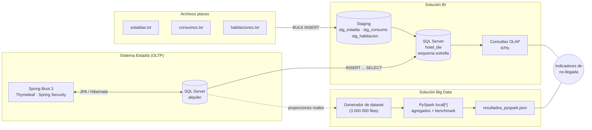
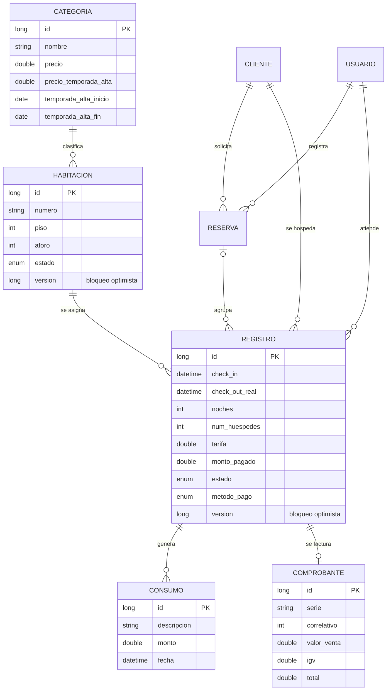
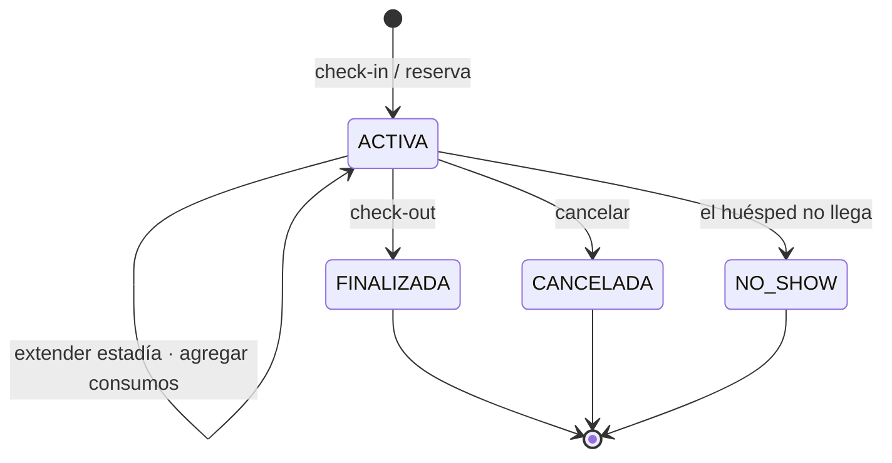
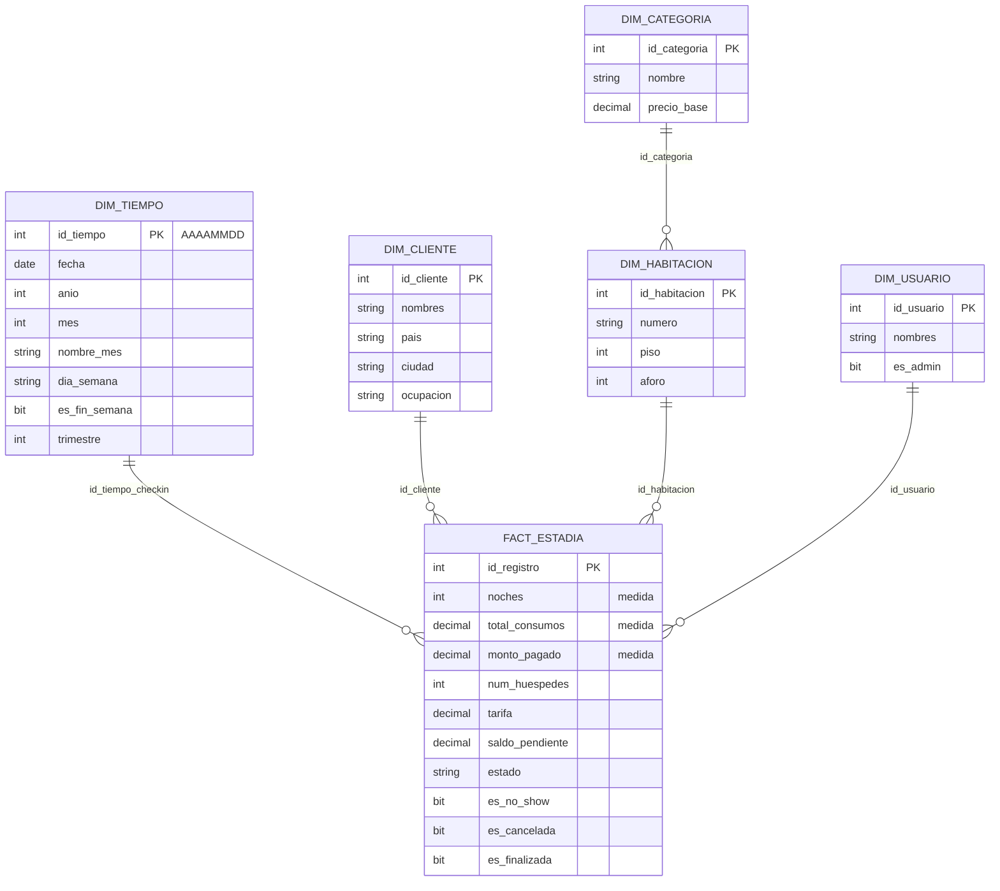
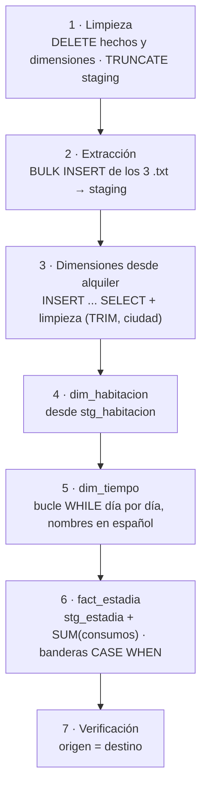

<div align="center">

# 🏨 Estadía · Tunki Lodge

**Sistema de gestión hotelera + Solución de Inteligencia de Negocios y Big Data**

*Factores asociados a la no-llegada de huéspedes en el sistema Estadía de Tunki Lodge*


</div>

---

## 📑 Tabla de contenidos

- [Descripción general](#-descripción-general)
- [Arquitectura](#-arquitectura)
- [Stack tecnológico](#-stack-tecnológico)
- [Aplicación Estadía (OLTP)](#-aplicación-estadía-oltp)
  - [Funcionalidades](#funcionalidades)
  - [Modelo de dominio](#modelo-de-dominio)
  - [Ciclo de vida de una estadía](#ciclo-de-vida-de-una-estadía)
  - [Seguridad](#seguridad)
  - [Rutas principales](#rutas-principales)
- [Instalación y ejecución](#-instalación-y-ejecución)
- [Configuración](#%EF%B8%8F-configuración)
- [Solución de Inteligencia de Negocios (datamart `hotel_dw`)](#-solución-de-inteligencia-de-negocios-datamart-hotel_dw)
- [Solución Big Data (PySpark)](#-solución-big-data-pyspark)
- [Pruebas](#-pruebas)
- [Estructura del repositorio](#-estructura-del-repositorio)
- [Limitaciones conocidas y trabajo futuro](#-limitaciones-conocidas-y-trabajo-futuro)
- [Equipo](#-equipo)

---

## 📌 Descripción general

El repositorio contiene dos piezas que trabajan sobre los mismos datos:

| Componente | Propósito | Tecnología |
|---|---|---|
| **Estadía** (OLTP) | Aplicación web que opera el hotel: clientes, habitaciones, reservas, check-in, consumos, check-out, cancelación y no-show. | Spring Boot 3 + SQL Server (`alquiler`) |
| **Solución BI** | Datamart en esquema estrella con proceso ETL desde la base operativa y archivos planos. | T-SQL, SQL Server (`hotel_dw`) |
| **Solución Big Data** | Procesamiento distribuido de un dataset a escala y benchmark de escalabilidad. | PySpark 4.2.0 (`local[*]`) |

**Problema de negocio.** La concurrencia de clientes en Tunki Lodge viene bajando y no existe una forma de explicar por qué. El evento medible más directo es la **no-llegada** del huésped (**no-show + cancelación**). El proyecto busca determinar si la no-llegada aumenta con el tiempo y en qué segmento se concentra:

- **Variable dependiente:** no-llegada (no-show + cancelación).
- **Variables independientes:** categoría de habitación, día de la semana y anticipación de la reserva.

---

## 🏗 Arquitectura



Ambas rutas (BI con datos reales y Big Data con volumen a escala) convergen en los mismos indicadores de no-llegada.

---

## 🧰 Stack tecnológico

| Capa | Tecnología | Versión |
|---|---|---|
| Lenguaje | Java (Eclipse Temurin) | 17 |
| Framework | Spring Boot (Web, Data JPA, Security, Thymeleaf, Actuator, DevTools) | 3.1.4 |
| ORM | Hibernate (vía Spring Data JPA) | gestionado por Spring Boot |
| Seguridad | Spring Security 6 · BCrypt | gestionado por Spring Boot |
| Base de datos | Microsoft SQL Server · driver `mssql-jdbc` | 2022 / 2025 |
| Utilidades | Lombok | gestionado por Spring Boot |
| Build | Maven Wrapper (`mvnw`) | incluido |
| Contenedor | Docker multi-stage (`eclipse-temurin:17-jdk-alpine` → `17-jre-alpine`) | — |
| BI / ETL | T-SQL: procedimientos almacenados, `BULK INSERT`, transacciones | — |
| Big Data | Python 3 + PySpark | 4.2.0 |

---

## 🖥 Aplicación Estadía (OLTP)

### Funcionalidades

- **Check-in / check-out** con cálculo automático de tarifa, noches y saldo pendiente.
- **Reservas múltiples:** una reserva puede cubrir varias habitaciones, cada una con su aforo y número de huéspedes.
- **Gestión de estados de la estadía:** finalizar (check-out), cancelar, marcar **no-show** y **extender**.
- **Consumos adicionales** asociados a cada estadía (minibar, servicios, etc.).
- **Comprobantes internos** con serie, correlativo, valor de venta e IGV (solo demostrativos, no válidos ante SUNAT).
- **Habitaciones** con estado (`DISPONIBLE`, `OCUPADA`, `LIMPIEZA`, `MANTENIMIENTO`) y **tarifa de temporada alta** por categoría.
- **Autocompletado de clientes por DNI** consultado desde el servidor a la API de apiperu.dev (el token nunca llega al navegador).
- **Exportación** del listado de registros, **búsqueda** global y **dashboard** operativo.
- **Usuarios** con rol administrador o staff, activación y desactivación de cuentas, y cambio de contraseña desde el perfil.

### Modelo de dominio



`Habitacion` y `Registro` usan **bloqueo optimista** (`@Version`) para evitar que dos usuarios modifiquen el mismo registro al mismo tiempo. La tabla `login_attempts` guarda cada intento de inicio de sesión (usuario, IP, hora y resultado).

### Ciclo de vida de una estadía



`CANCELADA` y `NO_SHOW` son los dos estados que el proyecto agrupa como **no-llegada**.

### Seguridad

| Mecanismo | Detalle |
|---|---|
| Autenticación | Formulario propio (`/login`) con Spring Security; contraseñas cifradas con **BCrypt**. |
| Autorización | Todo requiere sesión. `/usuarios/**` (crear, editar, activar, eliminar) exige rol **ADMIN**. |
| Bloqueo por intentos fallidos | Tras `security.login.maxAttempts` fallos dentro de `security.login.lockTimeMinutes`, la cuenta se bloquea temporalmente. Cada intento queda auditado en `login_attempts`. |
| CSRF | Activo (protección por defecto de Spring Security). |
| Logout | Invalida la sesión, borra `JSESSIONID` y registra la hora de cierre de sesión del usuario. |
| Secretos | La contraseña de la base de datos y el token de la API se leen desde variables de entorno. |

### Rutas principales

| Módulo | Ruta base | Operaciones |
|---|---|---|
| Registros (estadías) | `/` | listar, `hoy/`, `nuevo/`, `guardar/`, `editar/{id}/`, `checkout/{id}/`, `cancelar/{id}/`, `no-show/{id}/`, `extender/{id}/`, `eliminar/{id}/`, `exportar/` |
| Reservas | `/reservas/` | `nueva/`, `guardar/`, `{id}/` |
| Consumos | `/consumos/` | `{registroID}/`, `agregar/{registroID}/`, `eliminar/{id}/` |
| Comprobantes | `/comprobantes/` | `emitir/{registroID}/`, `ver/{registroID}/` |
| Habitaciones | `/habitaciones/` | CRUD, `disponibles`, `marcar-disponible/{id}/`, `calcular-tarifa/{id}` |
| Categorías | `/categorias/` | CRUD |
| Clientes | `/clientes/` | CRUD, `dni/{dni}` (autocompletado) |
| Usuarios *(ADMIN)* | `/usuarios/` | CRUD, `activar/{id}/`, `desactivar/{id}/` |
| Otros | `/dashboard/`, `/buscar`, `/perfil/` | panel, búsqueda global, perfil y cambio de contraseña |

---

## 🚀 Instalación y ejecución

### Requisitos previos

| Herramienta | Uso |
|---|---|
| JDK 17 | Compilar y ejecutar la aplicación |
| SQL Server 2022 o superior | Bases `alquiler` (OLTP) y `hotel_dw` (datamart) |
| SSMS o `sqlcmd` | Ejecutar los scripts de BI |
| Python 3 + PySpark 4.2.0 | Solo para la solución Big Data |
| Docker *(opcional)* | Ejecutar la app en contenedor |

> SQL Server debe tener **autenticación mixta** (SQL Server y Windows) y **TCP/IP habilitado en el puerto 1433**. En las ediciones Developer y Express, TCP viene desactivado por defecto y se activa desde *SQL Server Configuration Manager*.

### 1. Clonar el repositorio

```bash
git clone https://github.com/AlexAmancio/proyecto-bi-bigdata.git
cd proyecto-bi-bigdata
```

### 2. Crear la base operativa

```sql
CREATE DATABASE alquiler;
```

Hibernate crea las tablas automáticamente en el primer arranque (`spring.jpa.hibernate.ddl-auto=update`).

### 3. Definir variables de entorno

**Windows (PowerShell)**
```powershell
$env:DB_PASSWORD = "<contraseña de sa>"
$env:APIPERU_TOKEN = "<token de apiperu.dev>"   # opcional
```

**Linux / macOS**
```bash
export DB_PASSWORD='<contraseña de sa>'
export APIPERU_TOKEN='<token de apiperu.dev>'   # opcional
```

### 4. Ejecutar

```bash
./mvnw spring-boot:run          # Linux / macOS
.\mvnw.cmd spring-boot:run      # Windows
```

La aplicación queda disponible en **http://localhost:8090**.

### 5. Crear un usuario administrador

```sql
INSERT INTO usuario (apellidos, contrasena, correo, es_admin, activo, nombres, username)
VALUES ('Musk', '$2a$12$gx4jBU180qN4ohLJiyokkuRMZpnhtVmlsVJoCQFrKIeHaXTjI5m5G',
        'musk@gmail.com', 1, 1, 'Elon', 'elon');
```

Credenciales de prueba: **`elon` / `admin123`**.

### Ejecución con Docker

```bash
docker build -t estadia .
docker run -p 8090:8090 \
  -e DB_PASSWORD='<contraseña>' \
  -e SPRING_DATASOURCE_URL='jdbc:sqlserver://host.docker.internal:1433;databaseName=alquiler;encrypt=true;trustServerCertificate=true' \
  estadia
```

El `Dockerfile` usa un build multi-stage: compila con el JDK y ejecuta solo con el JRE, por lo que la imagen final es más liviana.

---

## ⚙️ Configuración

Archivo: `src/main/resources/application.properties`

| Propiedad | Valor por defecto | Descripción |
|---|---|---|
| `server.port` | `8090` | Puerto HTTP |
| `spring.datasource.url` | `jdbc:sqlserver://127.0.0.1:1433;databaseName=alquiler;encrypt=true;trustServerCertificate=true` | Conexión a SQL Server |
| `spring.datasource.username` | `${DB_USER:sa}` | Usuario de base de datos |
| `spring.datasource.password` | `${DB_PASSWORD:}` | Contraseña (solo por variable de entorno) |
| `spring.jpa.hibernate.ddl-auto` | `update` | Creación y actualización automática del esquema |
| `security.login.maxAttempts` | `3` | Intentos fallidos antes del bloqueo |
| `security.login.lockTimeMinutes` | `5` | Minutos de bloqueo |
| `apiperu.token` | `${APIPERU_TOKEN:...}` | Token para el autocompletado por DNI |

---

## 📊 Solución de Inteligencia de Negocios (datamart `hotel_dw`)

### Modelo dimensional

**Grano de la tabla de hechos:** una fila = una estadía (un registro de check-in).



| Elemento | Detalle |
|---|---|
| **Dimensiones (5)** | `dim_tiempo`, `dim_categoria`, `dim_habitacion`, `dim_cliente`, `dim_usuario` |
| **Medidas (4)** | `noches`, cantidad de estadías (`COUNT(*)`), `total_consumos`, `monto_pagado` |
| **Staging (3)** | `stg_estadia`, `stg_consumo`, `stg_habitacion` |

> `dim_habitacion` referencia a `dim_categoria` (una pequeña rama de copo de nieve), porque la categoría es el eje principal del análisis de no-llegada.

### Proceso ETL

| N.° | Fuente | Formato | Destino |
|---|---|---|---|
| 1 | Base `alquiler` | Tablas OLTP (`categoria`, `cliente`, `usuario`) | `dim_categoria`, `dim_cliente`, `dim_usuario` vía `INSERT ... SELECT` |
| 2 | `estadias.txt` | Separador `\|`, con encabezado | `stg_estadia` → `dim_tiempo` y `fact_estadia` |
| 3 | `consumos.txt` | Separador `\|`, con encabezado | `stg_consumo` → `total_consumos` |
| 4 | `habitaciones.txt` | Separador `,`, sin encabezado | `stg_habitacion` → `dim_habitacion` |



**Transformaciones aplicadas:**

- Clave de tiempo `AAAAMMDD` y calendario con mes y día de la semana en español.
- Limpieza de espacios (`LTRIM/RTRIM`) y normalización de la ciudad con mayúscula inicial.
- Agregación de consumos por estadía: `SUM(monto) ... GROUP BY registro_id`.
- Medida derivada: `saldo_pendiente = tarifa + total_consumos − monto_pagado`.
- Banderas `es_no_show`, `es_cancelada` y `es_finalizada` calculadas desde el estado.

El proceso completo vive en el procedimiento almacenado **`dbo.usp_etl_cargar_hotel_dw`**, dentro de una **transacción con `TRY/CATCH`**: si cualquier paso falla, se hace `ROLLBACK` y el datamart queda intacto.

### Ejecución del ETL

```powershell
# 1. Copiar las fuentes planas a la carpeta que lee BULK INSERT
mkdir C:\txt\tunki
copy bi\fuentes\*.txt C:\txt\tunki\

# 2. Crear el datamart y ejecutar el ETL
sqlcmd -S localhost -U sa -P "<contraseña>" -C -i bi\crear_hotel_dw.sql
sqlcmd -S localhost -U sa -P "<contraseña>" -C -i bi\etl_insert_select.sql
```

O directamente desde SSMS:

```sql
EXEC hotel_dw.dbo.usp_etl_cargar_hotel_dw @ruta = 'C:\txt\tunki\';
```

> `BULK INSERT` lee los archivos **desde el servidor**: la cuenta de servicio de SQL Server necesita permiso de lectura sobre la carpeta indicada en `@ruta`.

**Reconciliación esperada:** 21 estadías y S/ 2 075.00 de consumos, tanto en `alquiler` como en `hotel_dw`.

### Indicadores (KPIs)

| KPI | Fórmula | Valor actual |
|---|---|---|
| Tasa de no-llegada | (no-show + canceladas) / estadías × 100 | **14.3 %** |
| Concurrencia mensual | `COUNT(*)` por mes de check-in | ago 14 · sep 3 · oct 4 |
| Noches vendidas | `SUM(noches)` | 56 |
| Ingreso cobrado | `SUM(monto_pagado)` | S/ 3 210.00 |
| Ingreso por consumos | `SUM(total_consumos)` | S/ 2 075.00 |

Ejemplo de consulta OLAP (no-llegada por categoría):

```sql
SELECT c.nombre AS categoria,
       COUNT(*) AS estadias,
       ROUND(100.0 * SUM(CAST(f.es_no_show AS INT) + CAST(f.es_cancelada AS INT)) / COUNT(*), 1) AS pct_no_llegada
FROM fact_estadia f
JOIN dim_habitacion h ON f.id_habitacion = h.id_habitacion
JOIN dim_categoria  c ON h.id_categoria  = c.id_categoria
GROUP BY c.nombre
ORDER BY pct_no_llegada DESC;
```

| Categoría | Estadías | % no-llegada |
|---|---|---|
| Habitación Deluxe | 12 | 16.7 % |
| Habitación Estándar | 8 | 12.5 % |
| Suite Junior | 1 | 0.0 % |

---

## ⚡ Solución Big Data (PySpark)

El historial real (21 estadías en tres meses) no alcanza para medir una tendencia. Por eso se procesa un **dataset a escala de 3 000 000 de filas (2024–2026)**, calibrado con las proporciones reales del sistema.

| Etapa | Script | Detalle |
|---|---|---|
| Generación | `bigdata/generar_dataset_sintetico.py` | CSV de ~290 MB (no se versiona, se regenera). Semilla fija (`random.seed(42)`). |
| Procesamiento | `bigdata/analisis_pyspark.py` | Spark `local[*]`, `driver.memory=4g`, DataFrame en caché. |
| Resultados | `bigdata/resultados_pyspark.json` | Agregados por categoría, día, anticipación y mes, más el benchmark. |

```bash
pip install pyspark==4.2.0
python bigdata/generar_dataset_sintetico.py          # genera estadias_sinteticas.csv
python bigdata/analisis_pyspark.py                   # procesa y escribe resultados_pyspark.json
```

**Resultados de la última ejecución:**

| Segmento | % no-llegada |
|---|---|
| Habitación Deluxe | 36.75 % |
| Suite Junior | 30.99 % |
| Habitación Estándar | 25.45 % |
| Viernes / Lunes | 45.84 % / 42.73 % |
| Sábado | 18.27 % |
| Reservas con más de 10 días de anticipación | 35.69 % |

- **Concurrencia:** de 116 322 a 53 982 estadías mensuales (**−53.6 %**) entre el primer y el último mes.
- **No-llegada:** de 21.5 % a 39.2 % en el mismo periodo.

**Benchmark de escalabilidad** (mismo agregado sobre 3 000 000 de filas, máquina de 6 núcleos):

| Particiones | Tiempo (s) |
|---|---|
| 1 | 1.203 |
| 4 | 1.618 |
| 8 | 1.024 |
| 6 (= núcleos) | **0.944** |

> ⚠️ La tendencia temporal del dataset (caída de concurrencia y aumento de no-llegada) está **calibrada en el generador** para que el análisis tenga una señal que detectar. Los resultados de esta sección demuestran que el proceso escala, pero **no son una medición real del hotel**.

---

## 🧪 Pruebas

```bash
./mvnw test
```

| Clase | Qué valida |
|---|---|
| `RegistroTest` | Total de la estadía (tarifa + consumos), saldo pendiente y cálculo del checkout estimado |
| `LoginAttemptServiceTest` | Bloqueo de cuenta al alcanzar el máximo de intentos fallidos |
| `TextoUtilsTest` | Utilidades de normalización de texto |
| `SistemahotelApplicationTests` | Carga del contexto de Spring |

---

## 📁 Estructura del repositorio

```
proyecto-bi-bigdata/
├── src/main/java/com/example/sistemahotel/
│   ├── config/          # SecurityConfig, atributos globales del modelo
│   ├── controllers/     # Controladores MVC (registros, reservas, consumos, ...)
│   ├── interfaces/      # Contratos de la capa de servicio
│   ├── modelos/         # Entidades JPA y enums (EstadoRegistro, MetodoPago, ...)
│   ├── repositories/    # Repositorios Spring Data JPA
│   ├── security/        # Manejo de fallos de autenticación
│   ├── servicios/       # Lógica de negocio
│   └── util/            # Utilidades de fechas y texto
├── src/main/resources/
│   ├── templates/       # Vistas Thymeleaf
│   ├── static/          # CSS, JS e imágenes
│   └── application.properties
├── src/test/            # Pruebas unitarias (JUnit 5)
├── bi/
│   ├── crear_hotel_dw.sql        # DDL del datamart (dimensiones, hechos, staging)
│   ├── etl_insert_select.sql     # ETL: procedimiento usp_etl_cargar_hotel_dw
│   ├── fuentes/                  # estadias.txt · consumos.txt · habitaciones.txt
│   ├── arquitectura.png / .svg   # Diagrama de la arquitectura integrada
│   ├── datamart_estadia.sql      # Versión anterior del datamart (histórico)
│   └── extraer_generar_tsql.py   # ETL anterior desde MySQL (histórico)
├── bigdata/
│   ├── generar_dataset_sintetico.py
│   ├── analisis_pyspark.py
│   └── resultados_pyspark.json
├── informe/             # Informe técnico del proyecto
├── Dockerfile           # Build multi-stage (JDK → JRE)
└── pom.xml
```

---

## 🧭 Limitaciones conocidas y trabajo futuro

**Limitaciones actuales**

- El historial real es pequeño (21 estadías en tres meses), por lo que los porcentajes de la solución BI validan el modelo pero no permiten generalizar.
- El ETL hace una **carga completa** (borra y recarga el datamart) en cada ejecución.
- La anticipación de la reserva aún no está incorporada en `hotel_dw`; solo existe en el dataset a escala.
- `apiperu.token` tiene un valor por defecto en `application.properties`; debería definirse solo por variable de entorno.
- Al extender una estadía la tarifa no se recalcula automáticamente, y el monto de los consumos no se valida en el servidor.

**Próximos pasos**

- [ ] ETL **incremental** con `MERGE`, marca de agua, tabla de control `etl_control` y prueba de carga (500 → 15 000 registros).
- [ ] Incorporar la **anticipación de la reserva** (`reserva.fecha_creacion` vs. `registro.check_in`).
- [ ] Validar los hallazgos con un **dataset público real** de reservas hoteleras.
- [ ] **Dashboard en Power BI** conectado a `hotel_dw`.
- [ ] Modelo predictivo de no-llegada con **Spark MLlib** (regresión logística).

---

## 👥 Equipo

**Grupo 4**: Base de Datos Avanzadas y Big Data, UPN, 2026-2

| Integrante |
|---|
| Ayala Hernandez, Gerardo |
| Bringas Veramendi, Julio Cesar Ricardo |
| Osorio Carbajal, Mijai |
| Racchumi Julon, Yeremi Adrian |
| Valencia Amancio, Alex |
