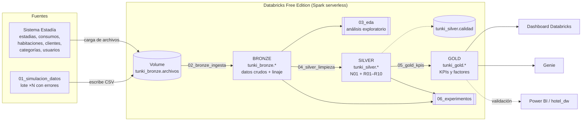
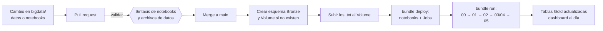

# Solución Big Data — Tunki Lodge (Databricks + arquitectura Medallion)

Segunda solución del proyecto: procesa con **Apache Spark en Databricks** los mismos datos de origen que la solución BI, los organiza en una **arquitectura Medallion (Bronze → Silver → Gold)** y presenta los indicadores de no-llegada en un **dashboard de Databricks**. Incluye un generador de datos simulados para probar la limpieza y la escalabilidad, y seis experimentos de rendimiento.

---

## 1. Qué responde

La misma pregunta de negocio de la solución BI: **¿por qué caen las reservas y en qué segmentos se concentra la no-llegada (cancelación + no-show)?**

Lo que agrega Big Data frente a BI:

| Aspecto | Solución BI (SQL Server) | Solución Big Data (Databricks) |
|---|---|---|
| Procesamiento | Un servidor, T-SQL | Distribuido en Spark (DataFrames) |
| Almacenamiento | Tablas SQL Server | Tablas **Delta Lake** con historial de versiones |
| Organización | Staging → estrella | **Medallion**: Bronze (crudo) → Silver (limpio) → Gold (KPIs) |
| Escala probada | Lotes de 500 a 15 000 estadías | De 9 mil a ~930 mil estadías (×1 a ×100) |
| Visualización | Power BI | Dashboard de Databricks + **Genie** (preguntas en lenguaje natural) |

---

## 2. Arquitectura



| Capa | Esquema | Tablas | Formato |
|---|---|---|---|
| Aterrizaje | Volume `workspace.tunki_bronze.archivos` | `sistema/*.txt`, `simulado/estadias/`, `simulado/consumos/` | Texto delimitado |
| Bronze | `workspace.tunki_bronze` | `estadias`, `consumos`, `habitaciones`, `clientes`, `categorias`, `usuarios` | Delta |
| Silver | `workspace.tunki_silver` | `estadias`, `consumos`, `clientes`, `habitaciones`, `calidad` | Delta |
| Gold | `workspace.tunki_gold` | `kpi_mensual`, `kpi_anual`, `no_llegada_segmento`, `ingreso_categoria`, `validacion_bi`, `experimentos` | Delta |

---

## 3. Estructura de la carpeta

```
bigdata/
├── datos/sistema/                 # Archivos fuente para subir al Volume
│   ├── estadias.txt               # 9 036 estadías (|)
│   ├── consumos.txt               # 7 096 consumos (|)
│   ├── habitaciones.txt           # 45 habitaciones (, sin encabezado)
│   ├── clientes.txt               # 6 594 clientes SIN datos personales (país, ciudad, ocupación)
│   ├── categorias.txt             # 6 categorías
│   └── usuarios.txt               # 9 usuarios (solo id y rol)
├── notebooks/                     # Importar en Databricks (formato fuente .py)
│   ├── 00_configuracion.py        # Esquemas, Volume, rutas y funciones comunes
│   ├── 01_simulacion_datos.py     # Lote simulado ×N con errores controlados
│   ├── 02_bronze_ingesta.py       # Capa Bronze
│   ├── 03_eda.py                  # Análisis exploratorio
│   ├── 04_silver_limpieza.py      # Capa Silver (reglas de calidad)
│   ├── 05_gold_kpis.py            # Capa Gold (KPIs) + validación con Power BI
│   └── 06_experimentos.py         # EXP-BD-01 a EXP-BD-06
├── dashboard/
│   ├── tunki_lodge.lvdash.json    # Dashboard de Databricks (lo despliega el bundle)
│   ├── generar_dashboard.js       # Genera el .lvdash.json (node generar_dashboard.js)
│   └── consultas_dashboard.sql    # Consultas de referencia de cada gráfico
├── databricks.yml                 # Asset Bundle: Jobs y tareas (lo despliega GitHub Actions)
└── evidencias/                    # Notebooks ejecutados (.ipynb/.html) y capturas
```

**Privacidad:** `clientes.txt` y `usuarios.txt` se exportaron **sin nombres, documentos, correos, teléfonos ni contraseñas**. Solo se conservan las columnas necesarias para el análisis (minimización de datos).

---

## 4. Datos

| Origen | Qué es | Cómo se identifica |
|---|---|---|
| **Sistema** | Los mismos archivos fuente que usa el ETL de BI (datos **antes** de transformar, no el datamart) | `origen = 'sistema'` |
| **Simulado** | Copias de las estadías reales ×`factor`, con ids nuevos y **errores inyectados** al 3 %: estado en minúsculas o nulo, método de pago vacío, monto nulo, noches en 0, tarifa negativa, cliente inexistente, fecha nula, filas duplicadas y mismo id con datos distintos | `origen = 'simulado'` |

El lote simulado existe porque el sistema entrega datos sin errores (las 11 reglas del ETL de BI encontraron 0 casos): sin él, la capa Silver no tendría nada que limpiar y no se podría medir la escalabilidad. Los errores se eligen con `hash(id)`, así que **cada ejecución genera los mismos** (reproducible).

---

## 5. Pipeline automático con GitHub Actions (recomendado)

Todo el proceso está **declarado como código**: el Job y sus tareas en [`databricks.yml`](databricks.yml) (Databricks Asset Bundle) y los pasos de despliegue en [`.github/workflows/deploy-bundle.yml`](../.github/workflows/deploy-bundle.yml). Nadie crea nada a mano en Databricks.



| Evento | Qué hace el pipeline |
|---|---|
| PR a `main` que toca `bigdata/` | Solo **valida** (sintaxis de notebooks y que estén los 6 archivos de datos). No toca Databricks |
| Merge a `main` con cambios en `bigdata/` | **Sube los datos**, **despliega** notebooks y Jobs, y **ejecuta** el pipeline Medallion |
| Botón *Run workflow* en la pestaña **Actions** | Lo mismo que el merge, a demanda |

**Agregar datos:** editar `bigdata/datos/sistema/estadias.txt` (u otro archivo) → PR → merge. El pipeline sube el archivo nuevo y recalcula Bronze, Silver y Gold.

**El pipeline queda en rojo si:** falla cualquier notebook, una tabla Gold queda vacía o la limpieza descarta más del 10 % de las estadías reales. La comparación con Power BI (`validacion_bi`) es informativa: si se agregaron datos, es normal que difiera.

**Configuración única (la hace el dueño del repositorio):**
1. En Databricks: *Settings → Developer → Access tokens → Generate new token*.
2. En GitHub: *Settings → Secrets and variables → Actions → New repository secret*:
   - `DATABRICKS_HOST`: URL del workspace (`https://dbc-xxxx.cloud.databricks.com`)
   - `DATABRICKS_TOKEN`: el token del paso 1 (nunca se escribe en el código)

En Databricks, los notebooks desplegados quedan en *Workspace → Users → (tu usuario) → .bundle → tunki_bigdata → prod* y los Jobs en *Jobs & Pipelines* ("Tunki Lodge - Pipeline Medallion" y "Tunki Lodge - Experimentos Big Data", este último se ejecuta a mano).

**Dashboard:** el bundle también despliega el dashboard **"Tunki Lodge - Reservas y no-llegada"** (*Dashboards* en el menú izquierdo), con tres páginas: Resumen, Factores de no-llegada y Calidad y experimentos. Está definido en [`dashboard/tunki_lodge.lvdash.json`](dashboard/tunki_lodge.lvdash.json); para cambiarlo se edita [`dashboard/generar_dashboard.js`](dashboard/generar_dashboard.js), se ejecuta `node bigdata/dashboard/generar_dashboard.js` y se integra por pull request.

---

## 6. Ejecución manual en Databricks (alternativa sin pipeline)

**Requisitos:** cuenta de Databricks Free Edition (https://www.databricks.com/es/learn/free-edition).

1. **Importar los notebooks.** *Workspace → (tu carpeta) → ⋮ → Import → File* y seleccionar los 7 archivos de `bigdata/notebooks/`. Deben quedar **en la misma carpeta** (usan `%run ./00_configuracion`).
2. **Crear esquemas y Volume.** Abrir `00_configuracion` y ejecutarlo (*Run all*). Crea `tunki_bronze`, `tunki_silver`, `tunki_gold` y el Volume `archivos`.
3. **Subir los archivos fuente.** *Catalog → workspace → tunki_bronze → Volumes → archivos → carpeta `sistema` → Upload to this volume* y subir los 6 archivos de `bigdata/datos/sistema/`.
4. **Ejecutar en orden** (*Run all* en cada uno):

   | Orden | Notebook | Tiempo aprox. | Resultado |
   |---|---|---|---|
   | 1 | `01_simulacion_datos` (widget `factor` = 1) | 1 min | Lote simulado en `simulado/` |
   | 2 | `02_bronze_ingesta` | 1 min | 6 tablas Bronze (estadías ≈ 18 400 filas) |
   | 3 | `03_eda` | 1–2 min | Tablas y gráficos exploratorios |
   | 4 | `04_silver_limpieza` | 1–2 min | Tablas Silver + bitácora `calidad` |
   | 5 | `05_gold_kpis` | 1 min | Tablas Gold + `validacion_bi` (todo debe decir **OK**) |
   | 6 | `06_experimentos` | 10–20 min | Tabla `experimentos` |

5. **Crear el dashboard.** *New → Dashboard*. En la pestaña **Data** agregar cada consulta de `dashboard/consultas_dashboard.sql` como dataset (D1 a D9) y en **Canvas** crear el gráfico indicado en el comentario de cada consulta. Publicar.
6. **Genie (opcional).** *New → Genie space*, agregar las tablas de `tunki_gold` y preguntar, por ejemplo:
   - "¿Qué zona de origen tiene mayor porcentaje de no-llegada?"
   - "Compara las reservas de 2026 con 2025 por mes"
   - "¿Qué método de pago tiene más cancelaciones?"

   Si se usa Genie, declararlo en la sección de uso de IA del informe.
7. **Guardar evidencias.** Exportar cada notebook ejecutado (*File → Export → IPython Notebook* o *HTML*) a `bigdata/evidencias/` y tomar capturas del dashboard.

---

## 7. Calidad de datos (Silver)

| Regla | Problema | Acción | Operación Spark |
|---|---|---|---|
| N01 | Estado / método de pago en minúsculas o con espacios | Normalizar | `upper(trim())` |
| R01 | Fila repetida | Conservar una | `dropDuplicates` |
| R01B | Mismo id con datos distintos | Descartar | `groupBy` + `left_anti` |
| R02 | Sin id o sin check-in | Descartar | `na.drop(subset)` |
| R03 | Estado no válido | Descartar | `filter(isin)` |
| R04 | Noches o huéspedes ≤ 0 | Descartar | `filter` |
| R05 | Tarifa nula o negativa | Descartar | `filter` |
| R06 | Monto pagado nulo | Corregir a 0 | `na.fill` |
| R07 | Método de pago vacío | `NO_REGISTRADO` | `na.replace` + `na.fill` |
| R08 | Cliente, habitación o usuario inexistente | Descartar | `left_semi` |
| R09 | Consumo huérfano | Descartar | `left_semi` |
| R10 | Consumo con monto ≤ 0 o nulo | Descartar | `filter` |

Son las mismas reglas del ETL de BI (R01–R10) más N01. Cada ejecución deja una fila por regla en `tunki_silver.calidad`.

---

## 8. Experimentos

| Código | Experimento | Configuración | Métrica |
|---|---|---|---|
| EXP-BD-01 | Escalabilidad por volumen | ×1, ×10, ×25, ×50, ×100, ×150, ×200, ×300 (con calentamiento previo) | Segundos de ingesta y de limpieza + KPIs |
| EXP-BD-02 | CSV frente a Delta | Lote ×50 | Segundos de lectura + agregación; MB en disco |
| EXP-BD-03 | Particionado por mes frente a sin partición | Lote ×50, consulta de diciembre | Segundos; número de archivos |
| EXP-BD-04 | `na.drop()` total frente a reglas | Bronze completo | Filas conservadas; desvío del % de no-llegada |
| EXP-BD-05 | Spark SQL frente a API DataFrames | Lote ×50 | Segundos |
| EXP-BD-06 | Número de particiones | Lote ×200; 1, 4, 16, 64 | Segundos |

Cada medición se repite 3 veces; se reporta promedio, desviación estándar, mínimo y máximo. Cada integrante del equipo es responsable de documentar uno.

---

## 9. Operaciones de Spark utilizadas

| Etapa | Operaciones |
|---|---|
| Carga | `spark.read` con esquema, `option("header")`, `option("sep")`, `_metadata.file_path` |
| Exploración | `display`, `printSchema`, `count`, `describe`, `percentile_approx`, `groupBy().count()`, `distinct`, conteo de nulos |
| Limpieza | `filter`, `select`, `drop`, `withColumnRenamed`, `withColumn`, `na.drop`, `na.fill`, `na.replace`, `dropDuplicates` |
| Integración | `join` (inner, left, left_semi, left_anti), `unionByName`, `crossJoin` |
| Agregación | `groupBy().agg()`, `sum`, `count`, `avg`, `stddev`, ventana `row_number` |
| Consulta | `createOrReplaceTempView`, `%sql`, `spark.sql` |
| Persistencia | `write.mode("overwrite").saveAsTable`, `partitionBy`, `DESCRIBE HISTORY`, `DESCRIBE DETAIL` |
| Rendimiento | `repartition`, comparación CSV/Delta, particionado |

---

## 10. Limitaciones

- **Cómputo serverless de la edición gratuita:** no se puede elegir el número de nodos ni su tamaño, así que la escalabilidad se mide aumentando el volumen, no los nodos. Hay cuota diaria de uso.
- **Datos simulados:** el lote ampliado replica las estadías reales; no aporta patrones de negocio nuevos, solo volumen y errores para las pruebas.
- **Primera repetición en frío:** el primer tiempo de cada escenario puede incluir el arranque del cómputo; por eso se repite 3 veces.
